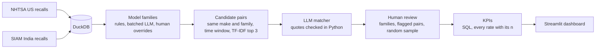

# recall-echo-monitor

**When a carmaker recalls a car in the US, does it recall the same car in India?**

This project lines up every US safety recall from NHTSA (2010 onwards) with India's voluntary-recall list from SIAM. It covers 10 carmakers that sell the same models in both markets. A DuckDB pipeline maps both sides' model names to shared model families and finds candidate US↔India recall pairs. An LLM then judges each pair, and Python checks the LLM's evidence: each quote it gives must really appear in the recall text. A person reviews the LLM's matches before any of them count in the results. A Streamlit dashboard shows echo rate, the lag between the two recalls, gaps by component, and over-the-air fixes. Every rate carries its n, and rates with n < 10 are hidden. A missing India recall is treated as a transparency signal, never as proof of wrongdoing.

## Headline results

Only numbers a person confirmed. Run of 2026-10-24; details in [notes.md](notes.md) and [reports/eval.md](reports/eval.md).

| result | value |
|---|---|
| Confirmed echo rate | **46 of 1,355** US campaigns (campaign × make) = **3.4%**. This is a lower bound: 60 of the LLM's 255 proposed matches have been reviewed so far |
| Confirmed echo rate by segment | luxury 35 of 902 = 3.9%; mass-market 11 of 453 = 2.4% |
| Lag, US recall to India recall | median **112 days** (n = 46); middle half 33 to 226 days; India recalled first in 6 of 46 |
| Matcher precision, random sample | **53 of 60 = 88.3%** (n = 60) of the LLM's proposed matches confirmed by a person, on a fixed-seed random sample |

Matcher accuracy against 30 pairs a person labelled blind (29 scored; 1 pair is no longer a candidate pair after the model-family review):

| | LLM matcher + evidence check | TF-IDF baseline |
|---|---|---|
| precision | 4 / 5 | 3 / 4 |
| recall | 4 / 4 | 3 / 4 |
| F1 | 8 / 9 | 6 / 8 |

These test-set figures have n < 10, so they're shown as fractions, not percentages. Both are flattered: the LLM prompt was refined on these pairs, and the baseline threshold was chosen on them.

<!-- Section 3, to fill in once reports/insights.md exists:
## Insights

Three findings, each with its n, in [reports/insights.md](reports/insights.md):

1. ...
2. ...
3. ...
-->

## Pipeline



<!-- Section 5, to fill in once the screenshots exist:
## Screenshots

| Overview | How it works | Recall explorer |
|---|---|---|
|  |  |  |
-->

## Run it end to end

1. **Set up:** create the environment and add an LLM key (see [Setup](#setup)). Then download the NHTSA file `FLAT_RCL_POST_2010.zip` into `data/raw/`; the link is in [docs/SOURCES.md](docs/SOURCES.md).
2. **Run the pipeline,** in this order, from the project root (Windows paths shown):

   ```bash
   .venv/Scripts/python.exe src/parse_siam.py          # SIAM CSVs from the saved HTML snapshot
   .venv/Scripts/python.exe -m src.load_nhtsa          # US recalls into DuckDB
   .venv/Scripts/python.exe -m src.load_siam           # India recalls into DuckDB
   .venv/Scripts/python.exe -m src.model_family        # model families: rules, batched LLM, reviewed overrides
   .venv/Scripts/python.exe -m src.candidates          # candidate US-India pairs
   .venv/Scripts/python.exe -m src.matcher --all       # LLM verdicts + evidence check (cached; reruns are free)
   .venv/Scripts/python.exe -m src.fetch_ota           # over-the-air flag from the NHTSA API (cached)
   .venv/Scripts/python.exe -m src.review              # apply human decisions, write the review queue
   .venv/Scripts/python.exe -m src.kpis                # KPI tables in data/clean/
   .venv/Scripts/python.exe -m src.evaluate            # reports/eval.md
   .venv/Scripts/python.exe -m pytest -q               # tests
   ```

   **After new model-family decisions,** `.venv/Scripts/python.exe -m src.review --rebuild` reruns the pipeline from the model-family step onwards.
3. **Open the dashboard:** run `.venv/Scripts/python.exe -m streamlit run app/dashboard.py` and open <http://localhost:8501>. The Review tab is where a person confirms or rejects matches.

## Limits

- **The confirmed echo rate is a lower bound.**
  - 195 of the LLM's 255 proposed matches are still unreviewed.
  - The LLM alone finds 169 of 1,355 (12.5%); the true rate lies between the two.
  - Per-carmaker confirmed rates mostly reflect which pairs fell into the sample, so they are not ranked.
- **Missed echoes are barely measured.** Recall rests on 4 positive test pairs, and the 1,404 pairs the LLM called "different" are not reviewed.
- **The test set is small, and was used for tuning.** It has 30 pairs, and both matchers were tuned on it.
- **One reviewer.** Precision rests on 60 sampled pairs reviewed by one person, and 5 of the 7 rejections are marked "unsure".
- **Model-family gaps:**
  - The 17 vocabulary items (possible same-model spellings) are not reviewed.
  - 6 India rows that name several models are mapped to one family each, so some echoes can be missed.
- **SIAM is voluntary.** Its list can be incomplete, and 10 flagged pairs had no India defect text to compare.
- **The over-the-air flag is a lower bound** (13 of 1,351 campaigns with a known flag). Some remedy texts say over-the-air while the API flag is false.

## Setup

Python 3.11+ required (built and verified on 3.13.7).

```bash
py -3 -m venv .venv
.venv/Scripts/python.exe -m pip install -r requirements.txt   # Windows
# source .venv/bin/activate && pip install -r requirements.txt  # macOS/Linux
```

Then add an LLM key for the Day 3 enrichment step:

```bash
cp .env.example .env     # then edit .env and set LLM_API_KEY
.venv/Scripts/python.exe -m src.llm --smoke   # verify it works
```

`.env` is gitignored; `.env.example` is the tracked template. Never commit a
real key.

### The LLM step runs on a free tier

[src/llm.py](src/llm.py) talks to any **OpenAI-compatible** provider, so the
provider is three environment variables rather than a code change. The
default is Google AI Studio, which needs no credit card:

1. Get a key at <https://aistudio.google.com/apikey>.
2. Put it in `.env` as `LLM_API_KEY`.
3. Run the smoke check above.

**Use a Flash-Lite model, not Flash.** As of late 2026 the Gemini Flash
models are capped near 20 requests/day on the free tier while Flash-Lite is
around 500/day — a 25x difference for this workload. Google no longer
publishes these numbers, so confirm your own at
<https://aistudio.google.com/rate-limit>. `.env.example` also carries ready
blocks for Groq, Mistral and OpenRouter.

Two habits the free tier forces, both already handled:

- **Every response is cached on disk** (`data/interim/llm_cache/`, keyed by
  model + prompt), so re-running a script costs zero requests and a crash
  mid-way never loses completed work.
- **Batch your records.** The binding limit is requests/day, not tokens, so
  use `batched()` to send many recalls per call — 355 rows at `size=20` is
  18 requests, not 355.

```python
from src.llm import complete, complete_json, batched

for chunk in batched(recalls, 20):
    rows = complete_json(f"Classify each defect...\n{chunk}")
```

Anthropic has no free tier, so `ANTHROPIC_API_KEY` is commented out in
`.env.example`; the `anthropic` package stays installed if you later switch.

## Layout

```
data/raw/          source data, as retrieved (see docs/SOURCES.md)
data/interim/      intermediate artifacts        (gitignored)
data/clean/        recalls.duckdb (gitignored) + cleaned outputs
src/               pipeline code
tests/             pytest
docs/SOURCES.md    provenance, shapes, and the data gotchas
```

Large and re-downloadable raw files (the NHTSA zip, the SIAM HTML snapshot)
are gitignored. The small curated CSVs are tracked.

## Data

| file | rows | what it is |
|---|---:|---|
| `data/raw/FLAT_RCL_POST_2010.zip` | 245,855 | NHTSA US recall records, 29 tab-delimited fields |
| `data/raw/RCL.txt` | — | NHTSA field layout |
| `data/raw/siam_recalls.csv` | 355 | SIAM India recalls, the 10 picked makes |
| `data/raw/siam_recalls_all.csv` | 546 | SIAM India recalls, every filer |
| `data/raw/india_makes.csv` | 10 | the picked makes + their join keys |
| `data/raw/india_models.csv` | 96 | what each make sells in India today |

The 10 makes — Toyota, Honda, Hyundai, Kia, Nissan, Volkswagen (mass-market)
and Mercedes-Benz, BMW, Audi, Volvo (luxury) — all sell cars in both markets
today and all appear in the SIAM data.

Rebuild the SIAM CSVs from the saved HTML snapshot:

```bash
.venv/Scripts/python.exe src/parse_siam.py            # from snapshot
.venv/Scripts/python.exe src/parse_siam.py --refresh   # re-download first
```

## Read this before writing matching code

`docs/SOURCES.md` has the full list, but the two that will cost you the most
time:

- **SIAM files recalls under the legal entity, not the brand.** One entity
  covers Volkswagen, Audi, Škoda, Porsche and Lamborghini. Grouping by
  manufacturer name hides all 35 Audi recalls.
- **Mercedes puts platform codes in the model field** (`205 (C-Class)`,
  `167 (GLE, GLS)`), not marketing names — and Mercedes is 149 of the 355
  India-side rows. Fuzzy matching on model text alone will miss them.

## Caveat on the India model lists

51 of the 96 model rows were read off official India sites. The other 45 —
all of Mercedes-Benz, BMW, Audi and Volvo — came from CarWale / Autocar India,
because those four official sites block automated fetches. Those rows are
marked `secondary_source` and should be verified by hand before being relied
on.
